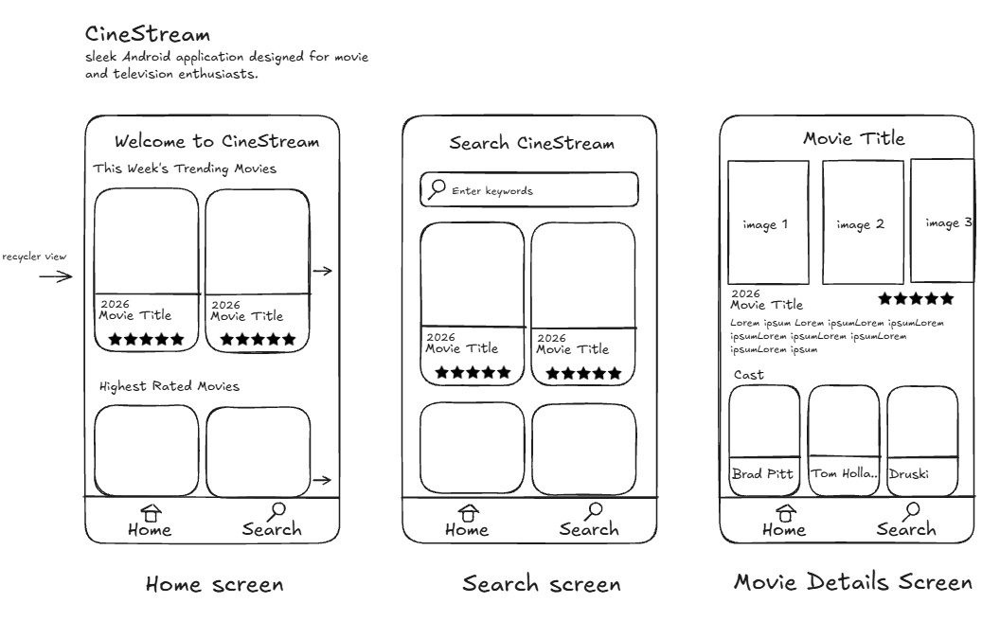

# CineStream

## Table of Contents

1. [App Overview](#app-overview)
1. [Product Spec](#product-spec)
1. [Wireframes](#wireframes)
1. [Build Notes](#build-notes)

## App Overview

### Description

CineStream is a sleek Android application for movie and television enthusiasts. It will use The Movie Database (TMDB) API to surface current trending titles, let users search a large catalog, and present useful movie metadata—including poster art, ratings, release dates, synopses, genres, and cast—in a clean, cinema-inspired dark interface.

### App Evaluation

- **Category:** Entertainment / Media Discovery
- **Mobile:** CineStream is designed for quick, touch-friendly discovery on Android. Users can scroll through posters, search from anywhere, and open detailed title information while deciding what to watch.
- **Story:** CineStream helps users move past the “what should we watch?” problem by making trending titles and rich movie information easy to explore.
- **Market:** The app serves a broad audience of moviegoers, critics, and casual viewers who want a straightforward way to browse entertainment.
- **Habit:** Users can return daily or weekly to see new trending titles and find recommendations for movie nights.
- **Scope:** Version 1 will focus on TMDB networking, a dynamic title feed, keyword search, title details, and a cohesive cinematic interface. A later version may add a local watchlist, genre filters, and alternate layouts.

## Product Spec

### 1. User Features (Required and Optional)

Required Features:

- **Trending feed:** Users can browse weekly trending movies in a poster-based feed.
- **Keyword search:** Users can enter a title in a search field and view matching movies from TMDB.
- **Movie details:** Users can select a movie card to view its poster, title, release date, score, genres, overview, and cast.
- **Custom cinematic UI:** Users can navigate a dark, cinema-inspired interface with gold accents, rounded movie cards, and clear typography.
- **Secondary touch action:** Users can long-press a movie card to receive quick feedback, such as a bookmark confirmation toast.

Stretch Features:

- **Local watchlist:** Users can save favorite movies on their device with Room.
- **Genre filtering:** Users can filter movies by genres such as Action, Comedy, Science Fiction, and Drama.
- **Grid-view toggle:** Users can switch between a scrolling list and a multi-column poster grid.

### 2. Chosen API(s)

- **The Movie Database (TMDB) API — `GET /3/trending/movie/week`**
  - Provides the current movie data for the required trending feed.
- **The Movie Database (TMDB) API — `GET /3/search/movie`**
  - Provides matching titles, poster paths, release dates, ratings, and summaries for the required keyword-search feature.
- **The Movie Database (TMDB) API — `GET /3/movie/{movie_id}` and `GET /3/movie/{movie_id}/credits`**
  - Provides the detailed metadata and cast information for the required movie-details screen.

### 3. User Interaction

**Trending Feed**

- User opens CineStream.
  - => The app retrieves weekly trending movies from TMDB and displays them as selectable movie cards.

**Keyword Search**

- User enters keywords in the search bar and taps Search.
  - => The app sends a TMDB search request and replaces the displayed results with matching movies.

**Movie Details**

- User taps a movie card in the trending feed or search results.
  - => The app opens the movie-details screen and displays the selected movie’s full poster, release date, rating, genres, synopsis, and cast.

**Secondary Touch Action**

- User long-presses a movie card.
  - => The app displays quick feedback, such as a Toast confirming that the title was bookmarked or inspected.

## Wireframes

The low-fidelity wireframes below show CineStream’s Home, Search, and Movie Details screens. They depict a trending feed, a keyword search field, selectable movie cards, bottom navigation, and the metadata shown after a user selects a title.

### [BONUS] Digital Wireframes & Mockups

Not included for this milestone.

### [BONUS] Interactive Prototype

Not included for this milestone.

## Build Notes

- The planned Android implementation will use Kotlin, Retrofit for REST API calls, Gson for JSON parsing, and Glide for loading online images.
- The app will manage transitions between the default weekly-trending feed and user search results.
- Reusable Material card styles and centralized theme definitions will support the dark cinema visual style.

For Milestone 2, include **2+ Videos/GIFs** of the build process here!

## License

Copyright **2026** **CineStream Team**

Licensed under the Apache License, Version 2.0 (the "License");
you may not use this file except in compliance with the License.
You may obtain a copy of the License at

    http://www.apache.org/licenses/LICENSE-2.0

Unless required by applicable law or agreed to in writing, software
distributed under the License is distributed on an "AS IS" BASIS,
WITHOUT WARRANTIES OR CONDITIONS OF ANY KIND, either express or implied.
See the License for the specific language governing permissions and
limitations under the License.
